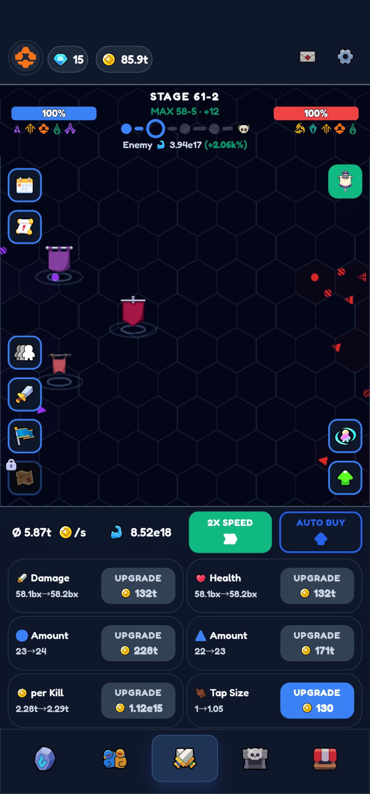

# Idle F1

A mobile-first idle racing game. Run your own F1 team, upgrade your cars, and beat the real-world teams to the Constructors' title.



## Overview

- **Platform:** mobile-first PWA (Phaser + TypeScript + Vite), Capacitor packaging later.
- **Style:** dark UI, 2D top-down track view with procedural scenery (grandstands, trees, ponds, sea and yachts, pit buildings, tyre walls, city blocks, desert dunes) that is unique and consistent per circuit, upgrade cards, bottom tab bar.
- **Seasons:** each season is a stage of 10 races. One of your drivers must win the Drivers' championship (2025 points) to advance. Also winning the Constructors' title skips a season (+2); a Drivers' 1-2 plus the Constructors' title skips two (+3). The Race tab's list toggles between race positions and season standings. Rivals get steadily stronger every season (steeply at first, then in a straight line past season 22). Balance is checked with a headless simulator (`BALANCE=1 npx vitest run src/game/balance.test.ts`): from a fresh save, each prestige reaches roughly 2-5 more seasons than the last.
- **Prestige & R&D:** once rivals are unbeatable, prestige from Season 3+ to return to Season 1 Race 1. The further you got, the more research points (RP) you earn. R&D is bought only with RP, on the same Prestige tab, and is permanent: Top Speed (faster on straights), Cornering (faster in corners), Tap Power, Tyre Science (less wear), Energy Recovery (tap boost lasts longer), Funding (+25% income and prizes) and Seed Money, plus free levels in each car stat. Each circuit's curvature is measured, so long-straight tracks reward Top Speed and twisty ones reward Cornering. Research, gems and Auto survive a prestige; money, car upgrades and sponsors reset.
- **Sponsors:** spend gems to book a meeting with a sponsor (each signed sponsor makes the next meeting cost more). Each has a hidden budget and you only see a rough range. Pitch an amount: at or under their budget they sign and pay that amount at the start of every new season, until you prestige; over it, talks collapse and the gems are lost. Gems currently come only from season titles.
- **Teams:** the player names their own team; rivals are real F1 teams and drivers.
- **Cars:** 2 per team; Constructors' points are the sum of both.
- **Team tab:** rename the team, pick a team colour, and see career stats (races won, drivers' and constructors' titles). Each race win brings 100 fans (kept through prestige). Once per prestige, run a Fan Event: money, gems, research points and clout each roll a chance to drop, scaled by fans.
- **Drivers:** each driver has a skill (percent boost to car rating) and three traits: Tyre Management (less wear), Consistency (fewer breakdowns) and Race Craft (pace at the start of a race, and less pace lost in the wet). Spend clout on the Team tab to meet a driver with a hidden minimum wage, offer a per-season salary and sign them into either seat. Salaries are paid once, after the final race of each season, and a driver you can't pay quits; Auto Buy saves up for the bill as the season goes on. Drivers and clout survive prestige.
- **Play:** tap to boost and make strategy calls for free. Each of your two cars has its own row of controls: push/normal/conserve mode, the next tyre (soft/medium/hard/intermediate/wet), and its own pit call. About 30% of races have rain, shown as a forecast badge: dry tyres lose a lot of pace on a wet track and wets lose pace when it dries, so watch the forecast. Rivals change tyres themselves, but slowly and with frequent mistakes. Each race starts with a short qualifying step that sets the starting grid from car rating plus a little luck, and a safety car that bunches the field and makes pitting cheap comes out whenever a car retires on track (roughly 1 race in 4). A new team starts around the back of the midfield (car rating 25), so Season 1 can be won on the first try in about 15 minutes. Tyres only change in the pit lane when the car reaches the start/finish line. Auto (auto-buy and auto-tap) is a paid unlock. Strategy can also be handed to a **race engineer**, recruited on the Team tab with clout and the same salary negotiation as drivers: three stats (pit calls, tyre choice, push/conserve) say how often they make the right call, one engineer manages both cars, they are paid once a season and quit if you can't pay, and they survive a prestige. Your own tyre choice always overrides theirs. **Car development** (Team tab) lets you commission one package at a time (Chassis, Aero or Power Unit); it costs money, takes 2-3 races, then rolls a flop, solid gain or breakthrough whose odds improve with your drivers' skill and your race engineer. The bonus lasts until the season ends, and rivals improve a little every race, so standing still means falling behind. Three **specialist staff** (Team tab, hired and paid like the engineer, kept through prestige) add modest edges: a tyre specialist cuts tyre wear by up to 15%, a pit crew chief shortens stops (up to 15%) and cuts pit problems (up to 35%), and a wind tunnel engineer improves car development odds. **Facilities** (Team tab) are three permanent buildings bought with gems, each up to level 100 and kept through prestige: the Factory adds up to +50% income and prize money, the Wind Tunnel adds up to +30% development team quality, and the Simulator cuts development flops by up to 50% and package prices by up to 25%. **Sound & haptics:** everything is synthesized with the Web Audio API (no asset files), so it works offline. There are effects for taps, pit stops, race start/finish, podiums, wins, safety cars, breakdowns, purchases and claims, an engine hum that follows the race, and a gentle looping music track, all on by default. Browsers keep audio locked until the first tap. The Profile page (person button next to the team name, top left of the Race tab) has toggles for sound effects, engine hum, music and vibration (Android only; iPhone ignores web vibration), plus a volume control, saved with the game. It also shows your team name with a rename button, career stats, and a two-tap **Reset save** that erases all progress on this device. **Tutorial:** a new team gets a skippable 5-step guided first race (tap, buy an Engine upgrade, strategy controls, goals and tabs, then a finish card). Finishing it, rather than skipping, pays a one-time gift of 25 gems and 25 clout; clout starts at 0. Existing saves skip it, and the Profile page has a Replay tutorial button (no second gift). **Goals** (button on the Race tab, red dot when something is ready) holds 28 achievements and three daily goals per day; tap to claim gems, clout or research points, and claiming all three daily goals pays a bonus that grows with a day-by-day streak. **Offline races:** while you're away the game plays one race per minute (2 h cap, or 8 h with Auto), driven by your race engineer only, with prize money 15% below live play. Titles advance you automatically, but never past the best season you reached before your last prestige; a "While you were away" screen shows the results and nothing counts until you tap Collect.

See [docs/SPEC.md](docs/SPEC.md) for the full v1 spec and [docs/ROADMAP.md](docs/ROADMAP.md) for the build order.

## Status

v1 playable: all six roadmap steps are implemented. Purchases and ads are stubs (see `src/game/monetization.ts`).

## Run

```
npm install
npm run dev     # local dev server
npm test        # unit tests
npm run build   # production build
```

## Credits

Real circuit outlines for all 40 tracks come from [bacinger/f1-circuits](https://github.com/bacinger/f1-circuits) (MIT License, unofficial data, not endorsed by Formula One Licensing B.V.).

## Contributing

Work is tracked through GitHub issues and the roadmap. Branch from `main`, open a PR, and link the issue it closes.
